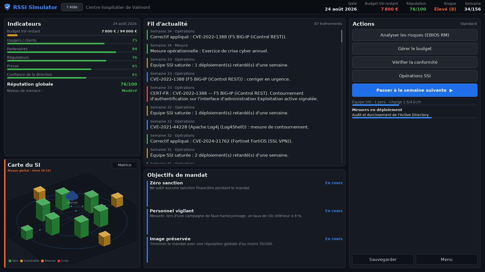
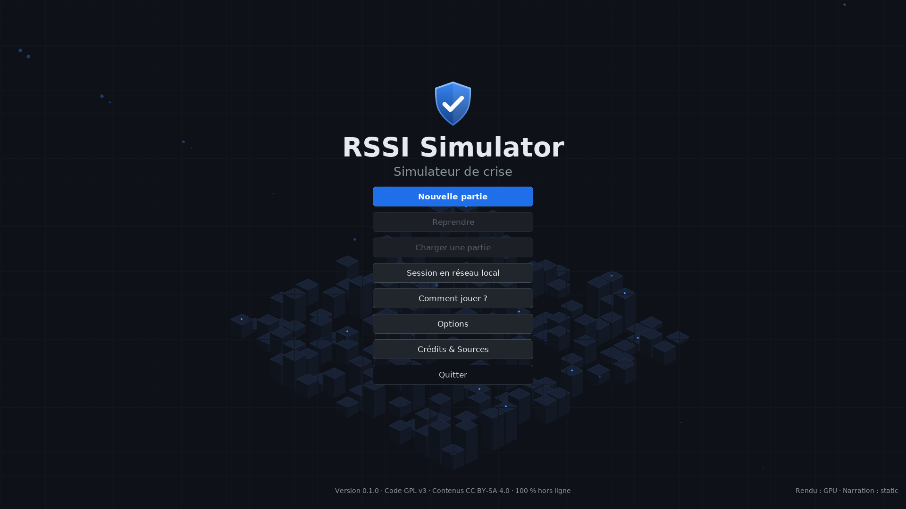
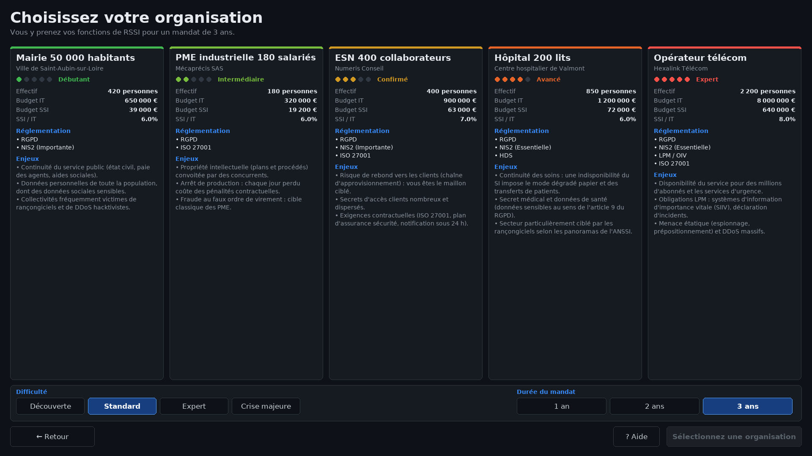
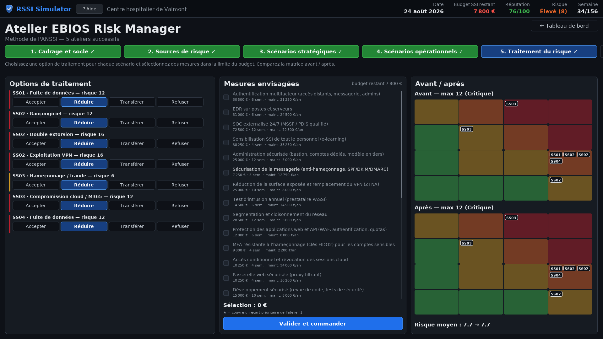
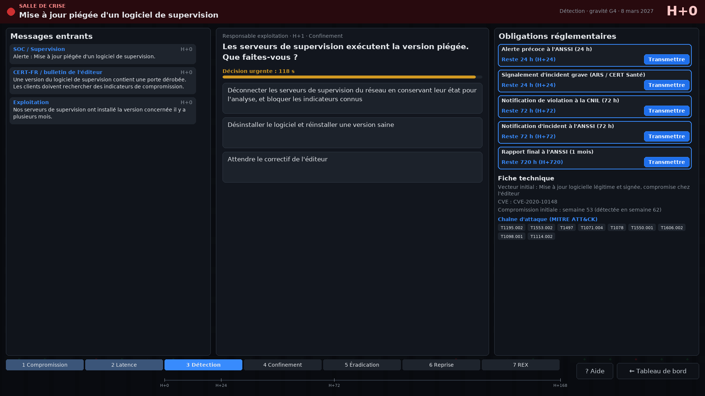
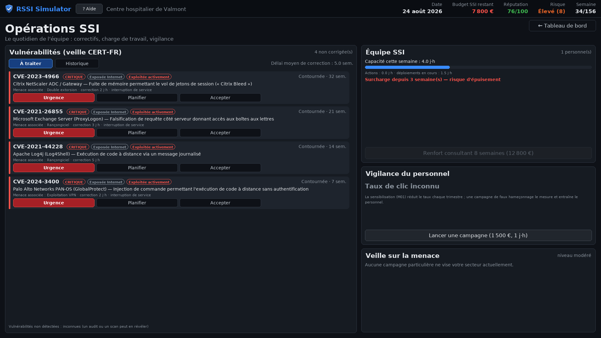
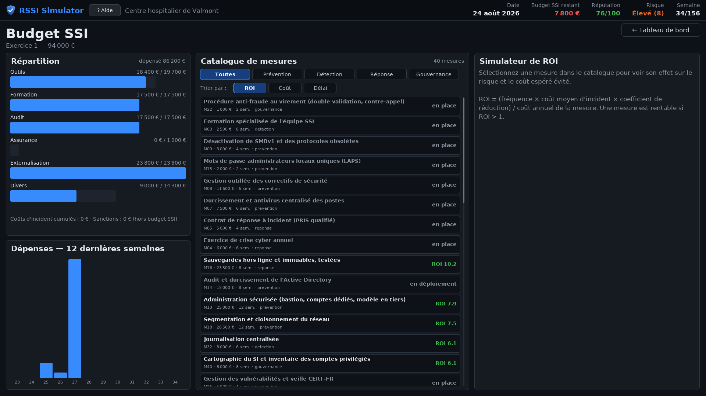
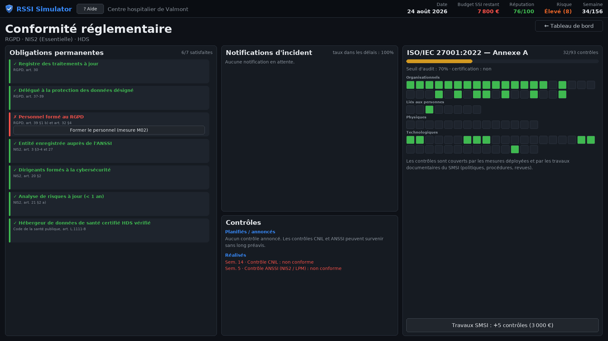
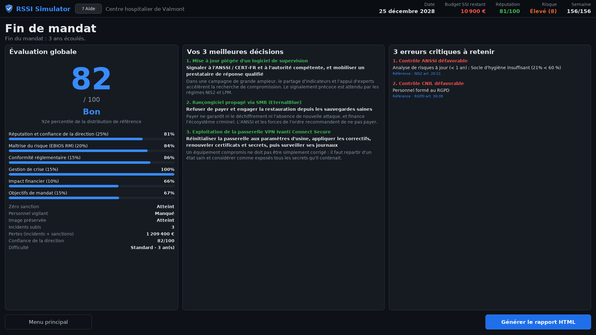
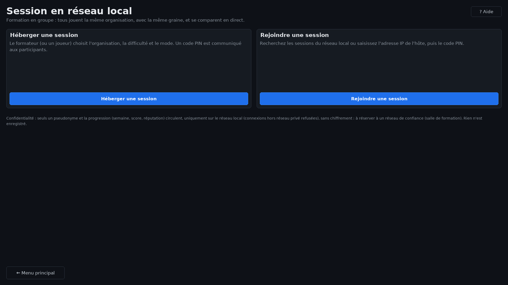

<div align="center">


# RSSI Simulator

**Prenez la place du RSSI pendant 3 ans. Survivez à la crise.**

Un jeu sérieux gratuit et open source, en français, pour apprendre la sécurité des systèmes
d'information en la pratiquant : EBIOS RM, budget, RGPD, NIS2, vulnérabilités et salle de crise.

<br>

[](../../releases/latest)

[](../../releases/latest)


[](LICENSE)
[](LICENSE-CONTENUS.md)
[](#comment-ce-jeu-a-été-fait)

[Jouer](#télécharger-et-jouer) &nbsp;|&nbsp;
[Captures](#captures-décran) &nbsp;|&nbsp;
[Formateurs](#pour-les-formateurs-et-les-écoles) &nbsp;|&nbsp;
[Sécurité](#sécurité-et-vie-privée) &nbsp;|&nbsp;
[Contribuer](#contribuer)

<br>



</div>

<br>

> Lundi matin, 8 h 30. Vous prenez vos fonctions de RSSI au centre hospitalier de Valmont.
> Le budget sécurité tient sur une demi-page, l'Active Directory n'a pas été audité depuis des
> années, et le CERT-FR vient de publier une alerte sur le VPN que vous utilisez.
>
> Vous avez 156 semaines pour faire de cet établissement une organisation qui résiste. Choisir
> les bonnes mesures, convaincre la direction, notifier la CNIL dans les 72 heures, garder votre
> équipe en vie. Et quand le rançongiciel arrive, c'est vous qui êtes en salle de crise.

## En bref

<table>
<tr>
<td width="33%" valign="top">

### Analyser
Les 5 ateliers **EBIOS Risk Manager** de l'ANSSI, jouables de bout en bout. La matrice de risque
évolue en direct avec vos choix.

</td>
<td width="33%" valign="top">

### Décider
**40 mesures** de sécurité avec coût, maintenance, délai de déploiement et retour sur
investissement. Le budget ne suffira jamais à tout faire.

</td>
<td width="33%" valign="top">

### Encaisser
**10 scénarios de crise** documentés et **26 CVE réelles**. Délais de notification, chaîne
d'attaque MITRE ATT&CK, décisions heure par heure.

</td>
</tr>
<tr>
<td valign="top">

### Rendre des comptes
Comités trimestriels, objectifs de mandat, réputation auprès des usagers, des régulateurs et de
la presse. Si la direction perd confiance, vous êtes remercié.

</td>
<td valign="top">

### Rester conforme
Registre **RGPD**, exigences **NIS2**, hygiène **ANSSI**, annexe A de l'**ISO 27001:2022**.
Les contrôles tombent, les sanctions aussi.

</td>
<td valign="top">

### Jouer à plusieurs
Session en **réseau local** pour toute une classe, avec la même partie pour tous et un
classement en direct.

</td>
</tr>
</table>

| Organisations | Difficultés | Durée d'un mandat | Incidents | Mesures | CVE réelles | Internet requis |
|:---:|:---:|:---:|:---:|:---:|:---:|:---:|
| **5** | **4** | **1 à 3 ans** | **10** | **40** | **26** | **non** |

## Pourquoi ce jeu

La cybersécurité s'apprend mal dans les slides. On retient une méthode quand on a dû l'appliquer
avec un budget trop court, une direction pressée et un incident en cours.

- **Étudiants** (BTS SIO, BUT, licences et masters cyber, écoles d'ingénieurs) : comprendre
  concrètement le métier de RSSI avant d'y être.
- **Professionnels** : préparer une prise de poste ou une certification ISO 27001, s'entraîner à
  la gestion de crise sans risque.
- **Formateurs** : un support vivant pour un TP, un module de sensibilisation ou une session en
  groupe.
- **Curieux** : découvrir à quoi ressemble vraiment la vie d'un responsable sécurité.

Tout s'appuie sur des sources réelles : méthode EBIOS RM et guide d'hygiène de l'ANSSI, RGPD,
directive NIS2, LPM, ISO 27001:2022, MITRE ATT&CK et vulnérabilités publiées.

## Ce que vous allez faire

**Choisir votre terrain de jeu.** Cinq organisations fictives, chacune avec ses contraintes, son
budget et sa réglementation : un hôpital, une mairie, une PME industrielle, une ESN et un
opérateur télécom.

**Analyser les risques comme un pro.** Cadrage et socle, sources de risque, scénarios
stratégiques, scénarios opérationnels, traitement du risque.

**Piloter un vrai budget.** MFA, EDR, SOC, segmentation, sauvegardes hors ligne, sensibilisation...
Une mesure n'est efficace qu'une fois déployée, et votre équipe a une capacité limitée.

**Survivre aux vulnérabilités.** Log4Shell, FortiOS, Ivanti, F5 BIG-IP... Les CVE tombent au fil
des semaines. Il faut prioriser, sinon c'est la surcharge, puis l'épuisement.

**Gérer la crise.** Rançongiciel, fraude au président, fuite par API, attaque de la chaîne
d'approvisionnement, DDoS, initié malveillant, double extorsion, vol de jeton Microsoft 365,
attaque sur des systèmes industriels. Chaque décision compte et les délais défilent.

**Repartir avec un bilan.** Score détaillé, meilleures décisions, erreurs à retenir et rapport
HTML à joindre à un dossier de formation.

## Captures d'écran

<table>
<tr>
<td width="50%"><p align="center"><b>Menu principal</b></p></td>
<td width="50%"><p align="center"><b>Choix de l'organisation et de la difficulté</b></p></td>
</tr>
<tr>
<td><p align="center"><b>Atelier EBIOS RM, matrice avant et après</b></p></td>
<td><p align="center"><b>Salle de crise et délais réglementaires</b></p></td>
</tr>
<tr>
<td><p align="center"><b>Opérations SSI : CVE, équipe, hameçonnage</b></p></td>
<td><p align="center"><b>Budget et catalogue de mesures</b></p></td>
</tr>
<tr>
<td><p align="center"><b>Conformité : RGPD, NIS2, ANSSI</b></p></td>
<td><p align="center"><b>Bilan de fin de mandat</b></p></td>
</tr>
</table>

## Télécharger et jouer

Rendez-vous sur la page **[Releases](../../releases/latest)** et prenez le fichier de votre
système. Aucune installation, aucun compte, aucune connexion.

| Système | Fichier | Lancement |
|---|---|---|
| Windows 10 / 11 | `rssi-simulator-windows.exe` | double-cliquer sur le fichier |
| Linux x86_64 | `rssi-simulator-linux-x86_64` | voir ci-dessous |

Sous Linux, le fichier téléchargé n'est pas encore exécutable :

- **depuis le gestionnaire de fichiers** : clic droit sur le fichier, **Propriétés**, activer
  l'exécution comme programme (sous GNOME : onglet **Permissions**, case **Autoriser l'exécution
  du fichier comme un programme**), puis double-cliquer dessus ;
- **depuis un terminal** :

  ```bash
  chmod +x rssi-simulator-linux-x86_64
  ./rssi-simulator-linux-x86_64
  ```

> [!NOTE]
> Au premier lancement sous Windows, SmartScreen peut afficher "Windows a protégé votre
> ordinateur", car l'exécutable n'est pas signé par un éditeur commercial. Cliquez sur
> **Informations complémentaires** puis **Exécuter quand même**.

<details>
<summary><b>Vérifier l'intégrité du fichier téléchargé</b></summary>

<br>

Chaque release publie un fichier `SHA256SUMS.txt`.

```powershell
# Windows
Get-FileHash .\rssi-simulator-windows.exe -Algorithm SHA256
```

```bash
# Linux
sha256sum -c SHA256SUMS.txt --ignore-missing
```

</details>

**Configuration conseillée :** écran 1280 x 720 minimum (1920 x 1080 recommandé), aucune carte
graphique dédiée, environ 100 Mo d'espace disque. Le binaire Linux est construit sur
Ubuntu 22.04 et fonctionne sur les distributions récentes (Debian 12, Fedora, Arch...).

## Premiers pas

1. **Nouvelle partie**, puis choisissez une organisation. La mairie et l'ESN sont les plus
   accessibles pour débuter.
2. Prenez la difficulté **Découverte** : une visite guidée et des bulles d'aide vous
   accompagnent.
3. Sur le tableau de bord, commencez par **Analyser les risques (EBIOS RM)** : c'est ce qui
   vous indique où mettre votre budget.
4. Passez les semaines avec le bouton bleu et surveillez le fil d'actualité : les alertes
   CERT-FR annoncent souvent l'incident d'après.
5. L'aide est accessible à tout moment avec le bouton **? Aide** ou la touche **F1**.

> [!TIP]
> Quelques conseils de RSSI :
> - Une vulnérabilité exploitée activement n'attend pas le prochain comité.
> - Regardez les délais de déploiement, pas seulement les prix.
> - En crise, notifier en retard coûte souvent plus cher que l'incident lui-même.
> - Votre équipe n'est pas extensible. Une équipe épuisée fait des erreurs.

## Pour les formateurs et les écoles



### Session en réseau local

Toute une classe joue la même partie en même temps, avec un classement en direct.

1. Le formateur choisit **Session en réseau local**, puis **Héberger**. Il règle l'organisation,
   la difficulté, la durée et le mode, puis communique le **code PIN** et l'adresse IP.
2. Les participants choisissent **Rejoindre**, puis **Rechercher** (ou saisissent l'adresse IP)
   et entrent le PIN.
3. Le formateur clique sur **Lancer la partie**. Tout le monde a la même organisation et les
   mêmes événements : seules les décisions changent.

En mode **synchronisé**, la semaine suivante n'arrive que lorsque tous les joueurs sont prêts.
Idéal pour débriefer ensemble après chaque crise.

Ports utilisés : `47111/TCP` (session) et `47110/UDP` (découverte automatique, facultative).

<br clear="right">

### Idées d'usage pédagogique

| Format | Déroulé |
|---|---|
| **TP de 2 heures** | Mandat de 1 an en difficulté Standard, rapport HTML rendu en fin de séance. |
| **Module EBIOS RM** | Réaliser les 5 ateliers dans le jeu, puis comparer les choix de traitement entre groupes. |
| **Exercice de crise** | Session réseau synchronisée, débrief collectif après chaque incident. |
| **Sensibilisation** | Montrer à des non-spécialistes ce que coûte un incident et pourquoi la sécurité demande du temps. |

Les formules, sources et hypothèses du modèle sont détaillées dans
[docs/METHODOLOGIE.md](docs/METHODOLOGIE.md), pour pouvoir expliquer chaque chiffre aux
apprenants.

Chaque partie a une graine aléatoire : en la notant, on rejoue exactement la même partie.

```bash
rssi-simulator --scenario hopital --seed 42 --difficulty expert
```

## Utilisation libre et gratuite

RSSI Simulator est **gratuit** et le restera. Vous pouvez, sans demander d'autorisation :

- y jouer, chez vous ou au travail ;
- l'utiliser **en cours, en formation, en école, en université ou en entreprise**, y compris
  dans une formation payante ;
- le distribuer à vos apprenants et l'installer sur les postes d'une salle de formation ;
- l'adapter : ajouter vos organisations, incidents ou mesures, le traduire, le modifier.

La seule condition : citer le projet et, si vous diffusez une version modifiée, la partager sous
la même licence (voir [Licences](#licences)). Un petit mot pour dire où le jeu est utilisé fait
toujours plaisir, via une issue ou une discussion.

## Sécurité et vie privée

Un jeu sur la cybersécurité se doit d'être irréprochable sur ce point.

| | |
|---|---|
| **Aucune donnée collectée** | Pas de compte, pas de télémétrie, pas de statistiques envoyées. Détails dans [docs/RGPD.md](docs/RGPD.md). |
| **Aucune connexion Internet** | Aucune bibliothèque d'accès à Internet dans le code, vérifié par un test automatique. |
| **Réseau local uniquement** | Multijoueur désactivé par défaut, toute adresse publique est refusée. |
| **Protocole durci** | Messages JSON bornés et validés, limitation de débit, PIN protégé contre la force brute. |
| **Sauvegardes protégées** | SQLite avec empreinte SHA-256 : une sauvegarde modifiée est détectée et refusée. |
| **Rapport autonome** | Le rapport HTML ne contient aucun script ni ressource externe. |
| **Binaires vérifiables** | Construits publiquement par GitHub Actions, avec empreintes SHA-256. |

> [!IMPORTANT]
> Le trafic du mode réseau local n'est pas chiffré. Il est prévu pour une salle de formation,
> pas pour un réseau public.

Vous avez trouvé une faille ? Merci de lire [SECURITY.md](SECURITY.md) avant d'ouvrir une issue.

## Lancer depuis les sources

Prérequis : Python 3.10 à 3.12.

```bash
git clone https://github.com/0xKuraishY/rssi-simulator.git
cd rssi-simulator
make install        # crée .venv et installe les dépendances
make run            # lance le jeu
```

<details>
<summary><b>Windows sans make</b></summary>

<br>

```bat
py -3.12 -m venv .venv
.venv\Scripts\python -m pip install -r requirements.txt
.venv\Scripts\python main.py
```

</details>

<details>
<summary><b>Ligne de commande</b></summary>

<br>

```
python main.py [--scenario hopital|mairie|pme_industrie|esn|telecom] [--seed N]
               [--difficulty decouverte|standard|expert|crise] [--years 1|2|3]
               [--resolution 1280x720] [--fullscreen]
python main.py --headless --scenario mairie --seed 42 --strategy expert
```

Le mode `--headless` joue une partie complète sans affichage. Il sert à l'intégration continue
et au calibrage de la difficulté.

</details>

<details>
<summary><b>Tests et construction des exécutables</b></summary>

<br>

```bash
make test           # suite de tests (plus de 200 tests, sans affichage)
make coverage       # couverture du moteur de jeu, échec sous 80 %
make package-linux  # binaire autonome dist/rssi-simulator
make package-win    # sous Windows : dist\rssi-simulator.exe
```

</details>

<details>
<summary><b>Narration par IA locale (facultatif)</b></summary>

<br>

Le jeu peut générer les messages de crise avec un modèle de langage qui tourne sur votre machine
(llama.cpp). Rien n'est envoyé nulle part, et le jeu est complet sans.

```bash
make install-ai
```

Déposez ensuite un modèle `.gguf` dans le dossier `models/` du répertoire de données du jeu
(`%APPDATA%\rssi-simulator\models` sous Windows, `~/.local/share/rssi-simulator/models` sous Linux).

</details>

<details>
<summary><b>Organisation du code</b></summary>

<br>

```
engine/     boucle Pygame, rendu, sauvegarde SQLite, audio
game/       moteurs de simulation : risque EBIOS RM, incidents, budget, conformité,
            réputation, opérations, gouvernance, difficulté, score, rapport
ui/         écrans et composants d'interface
net/        multijoueur en réseau local (protocole, découverte, hôte, client)
scenarios/  organisations, incidents et événements (YAML)
data/       mesures, menaces, MITRE ATT&CK, référentiels réglementaires
ai/         narration locale facultative
assets/     polices, logo et icônes
docs/       méthodologie, protection des données, captures d'écran
```

</details>

## Contribuer

Toutes les contributions sont bienvenues, même petites :

- **Nouveaux scénarios d'incident** : un fichier YAML dans `scenarios/incidents/` suffit, sans
  écrire de code.
- **Nouvelles organisations** : une collectivité, une université, un cabinet d'avocats, un
  laboratoire...
- **Corrections réglementaires ou techniques** : un délai, un article ou une CVE mal décrit ?
  Signalez-le.
- **Retours de formateurs** : ce qui marche en cours, ce qui manque.
- **Code** : corrections, accessibilité, traduction.

Le guide est dans [CONTRIBUTING.md](CONTRIBUTING.md).

## Comment ce jeu a été fait

RSSI Simulator a été développé avec [Claude Code](https://claude.com/claude-code), l'assistant
de programmation d'Anthropic. Le code, les tests, les scénarios et cette documentation ont été
écrits avec son aide, sous la direction de [0xKuraishY](https://github.com/0xKuraishY) qui a
défini le jeu, ses règles et ses choix pédagogiques, et qui a relu le résultat.

### Sources et respect des droits

Le contenu du jeu s'appuie uniquement sur des sources publiques, citées dans l'écran
**Crédits & Sources** et détaillées dans [docs/METHODOLOGIE.md](docs/METHODOLOGIE.md). Chacune
est réutilisée dans le respect de ses conditions :

| Source | Utilisation dans le jeu | Conditions respectées |
|---|---|---|
| **ANSSI** (EBIOS RM, guide d'hygiène, guides de crise, panoramas) | Méthode, intitulés des 42 mesures d'hygiène, tendances de la menace | Licence Ouverte d'Etalab, source citée |
| **MITRE ATT&CK** | Identifiants et noms des techniques d'attaque | Conditions d'utilisation de MITRE, mention de copyright reproduite |
| **CVE** publiées (CERT-FR, CISA) | 26 vulnérabilités réelles | Identifiants publics, descriptions réécrites en français, aucun score recopié |
| **Textes officiels** (RGPD, NIS2, codes français) | Délais, obligations et articles | Textes publics librement réutilisables, articles cités |
| **ISO/IEC 27001:2022** | Numéros et intitulés des 93 contrôles | Traductions libres et résumées, aucun texte de la norme reproduit |
| **Études de coûts** (Hiscox, CESIN, AMRAE) | Ordres de grandeur pédagogiques | Fourchettes citées, aucun extrait reproduit |

Les organisations et les personnages sont fictifs. Aucun texte protégé n'est copié tel quel :
les scénarios et les explications ont été rédigés pour le jeu.

> [!NOTE]
> Les chiffres de calibrage et quelques références précises sont listés dans la section
> *Références à vérifier* de [docs/METHODOLOGIE.md](docs/METHODOLOGIE.md), pour qu'un relecteur
> puisse les confronter aux publications officielles. Vous avez repéré une erreur ? Ouvrez une
> issue, toute correction est la bienvenue.

## Licences

- **Code source** : [GNU GPL v3](LICENSE)
- **Contenus pédagogiques** (scénarios, données, textes) : [CC BY-SA 4.0](LICENSE-CONTENUS.md)
- **Polices DejaVu** : licence libre, voir `assets/fonts/LICENSE-DejaVu.txt`
- MITRE ATT&CK est une marque de The MITRE Corporation.

Les organisations du jeu sont fictives. Les montants, probabilités et sanctions sont des modèles
pédagogiques documentés dans [docs/METHODOLOGIE.md](docs/METHODOLOGIE.md) : ils ne constituent
ni un barème officiel ni un conseil juridique.

<br>

<div align="center">


**Si le jeu vous a appris quelque chose, laissez une étoile au dépôt.**
<br>C'est ce qui aide les autres à le trouver.

</div>
